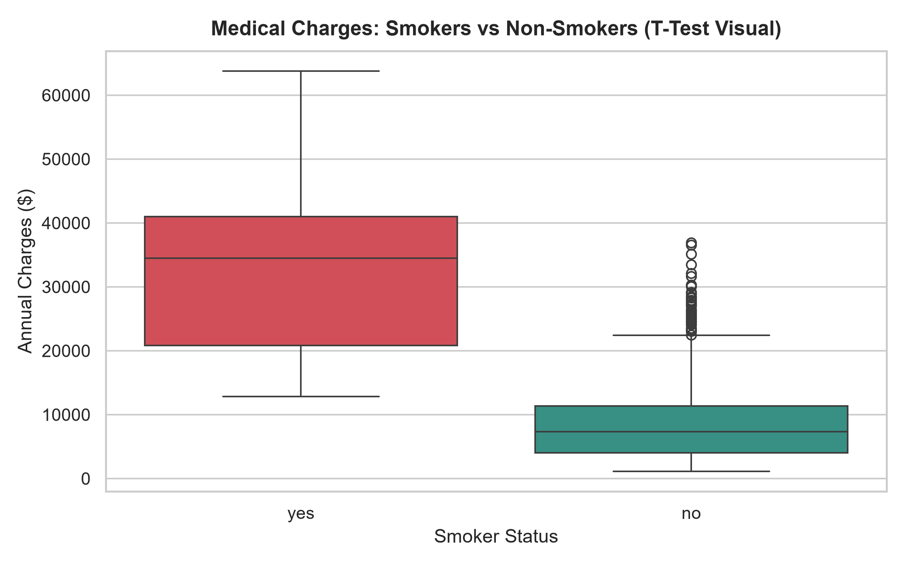
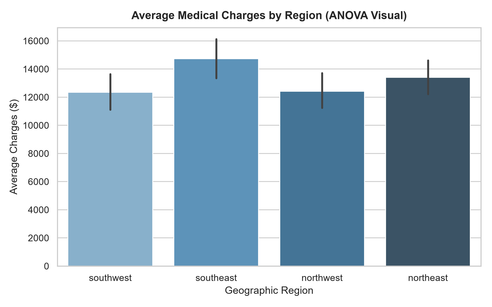
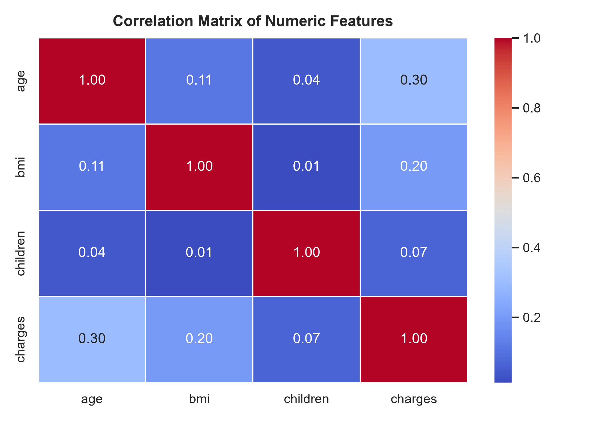
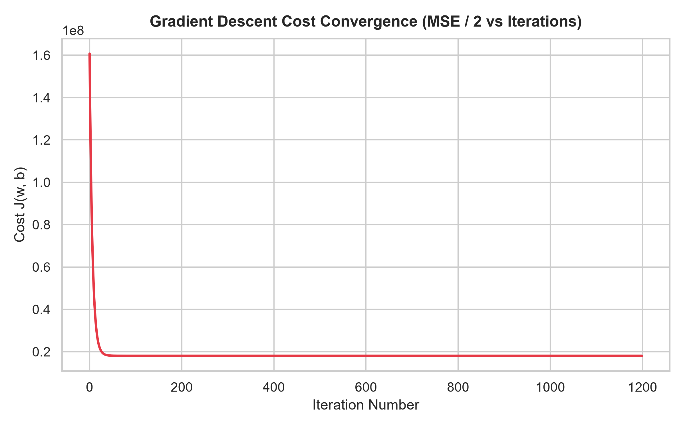
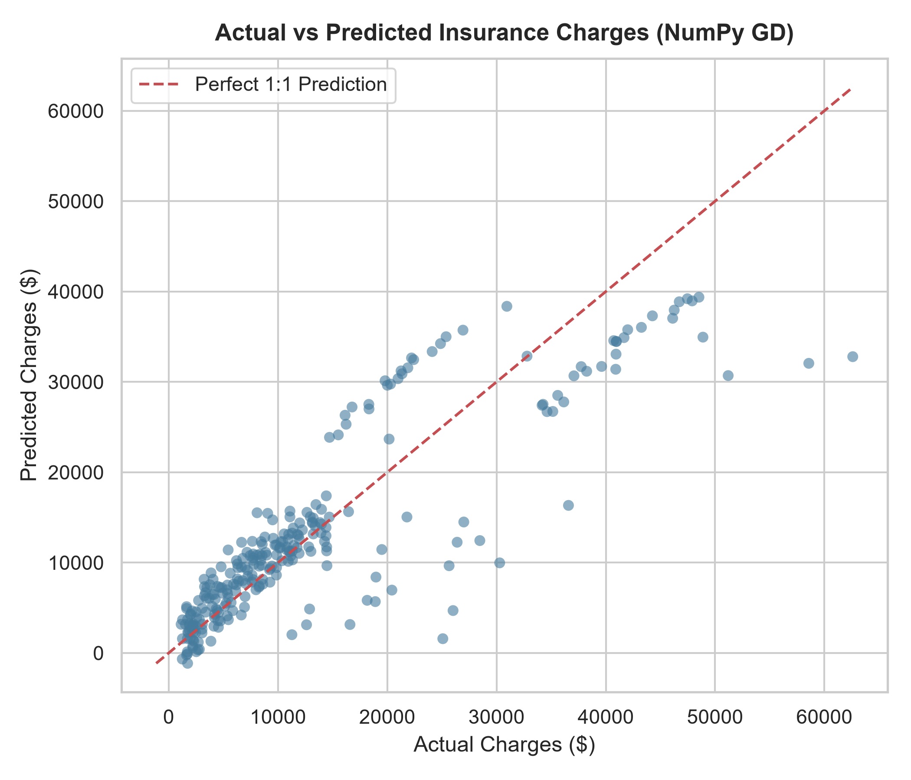

# 📈 Day 27: Statistical EDA & NumPy Linear Regression (from Scratch)

Hey everyone! For **Day 27** of my AI/ML roadmap, I built this project to master two foundational skills in data science and machine learning:
1. **Hypothesis Testing & Statistical Inference** on real-world data.
2. **Implementing Multiple Linear Regression with Gradient Descent from Scratch using pure NumPy** — without relying on Scikit-Learn's prebuilt solver for the math.

---

## 💡 The Dataset: Medical Insurance Costs (`insurance.csv`)
I used the classic medical insurance dataset (1,338 patients) with features:
- `age`: Age of the primary beneficiary
- `sex`: Gender (male / female)
- `bmi`: Body Mass Index
- `children`: Number of dependents
- `smoker`: Smoking status (yes / no)
- `region`: Beneficiary's residential area in the US (northeast, northwest, southeast, southwest)
- `charges`: Individual medical costs billed by health insurance (**continuous target variable**)

---

## 🔬 Part 1: Statistical Hypothesis Testing

Before training any machine learning model, I performed 5 key statistical tests to understand the underlying distributions and relationships:

### 1. Two-Sample Independent T-Test (Smokers vs. Non-Smokers)
- **Question:** Does smoking significantly impact medical charges?
- **Hypotheses:**
  - $H_0$: Mean charges for smokers = Mean charges for non-smokers.
  - $H_1$: Mean charges for smokers $\neq$ Mean charges for non-smokers.
- **Results:**
  - Non-smoker average charge: **$8,434.27**
  - Smoker average charge: **$32,050.23**
  - T-Statistic: **32.75**, p-value: **$5.89 \times 10^{-103}$**
- **Conclusion:** **Reject $H_0$ ($p < 0.05$)**. Smokers incur almost **4x higher medical charges** than non-smokers. This is the single strongest predictor in the dataset.

---

### 2. One-Way ANOVA (Charges across 4 Geographic Regions)
- **Question:** Do average charges differ significantly by region?
- **Hypotheses:**
  - $H_0$: Mean charges are equal across all 4 regions (Northeast, Northwest, Southeast, Southwest).
  - $H_1$: At least one region has a statistically different mean charge.
- **Results:**
  - Southeast: **$14,735.41** | Northeast: **$13,406.38** | Northwest: **$12,417.58** | Southwest: **$12,346.94**
  - F-Statistic: **2.97**, p-value: **0.0309**
- **Conclusion:** **Reject $H_0$ ($p < 0.05$)**. There is a statistically significant regional variation, driven primarily by the Southeast region having both higher average BMI and charges.

---

### 3. Chi-Square Test of Independence (Gender vs. Smoker)
- **Question:** Is smoking status independent of gender?
- **Results:**
  - Contingency table shows **159 male smokers** vs **115 female smokers**.
  - $\chi^2$ Statistic: **7.39**, p-value: **0.0065**
- **Conclusion:** **Reject $H_0$ ($p < 0.05$)**. Smoking status is dependent on gender in this sample, with males showing a higher smoking propensity.

---

### 4. Pearson Correlation & Significance
- **Age vs Charges:** $r = +0.2990$ ($p = 4.89 \times 10^{-29}$) -> Statistically significant positive correlation.
- **BMI vs Charges:** $r = +0.1983$ ($p = 2.46 \times 10^{-13}$) -> Statistically significant positive correlation.

---

### 5. Normality Test (D'Agostino's $K^2$)
- Skewness: **+1.5159** (heavily right-skewed distribution).
- p-value: **$7.02 \times 10^{-74}$** ($p < 0.05$).
- **Takeaway:** Target charges do not follow a Gaussian bell curve, which is typical for financial and healthcare expenditure data where a minority of patients incur very high costs.

---

## 🧠 Part 2: Linear Regression from Scratch (NumPy)

Instead of calling `sklearn.linear_model.LinearRegression`, I implemented the math by hand:

### 1. The Math Behind the Code:
* **Hypothesis:**
  $$\hat{y} = Xw + b$$
* **Cost Function (Mean Squared Error / 2):**
  $$J(w, b) = \frac{1}{2m} \sum_{i=1}^{m} (\hat{y}_i - y_i)^2$$
* **Gradients (Derivatives with respect to weights and bias):**
  $$\frac{\partial J}{\partial w} = \frac{1}{m} X^T (\hat{y} - y)$$
  $$\frac{\partial J}{\partial b} = \frac{1}{m} \sum_{i=1}^{m} (\hat{y}_i - y_i)$$
* **Update Rule:**
  $$w := w - \alpha \frac{\partial J}{\partial w}$$
  $$b := b - \alpha \frac{\partial J}{\partial b}$$
  *(where $\alpha$ is the learning rate)*

### 2. Implementation:
```python
class LinearRegressionGD:
    def __init__(self, learning_rate=0.08, n_iterations=1200):
        self.lr = learning_rate
        self.n_iters = n_iterations
        self.weights = None
        self.bias = None
        self.cost_history = []

    def fit(self, X, y):
        m, n = X.shape
        self.weights = np.zeros(n)
        self.bias = 0.0
        
        for i in range(self.n_iters):
            y_pred = np.dot(X, self.weights) + self.bias
            error = y_pred - y
            cost = (1.0 / (2.0 * m)) * np.sum(error ** 2)
            self.cost_history.append(cost)

            # Gradients
            dw = (1.0 / m) * np.dot(X.T, error)
            db = (1.0 / m) * np.sum(error)

            # Gradient descent step
            self.weights -= self.lr * dw
            self.bias -= self.lr * db
            
    def predict(self, X):
        return np.dot(X, self.weights) + self.bias
```

---

## 🏆 Benchmark: NumPy Model vs. Scikit-Learn

To verify the mathematical correctness of my NumPy gradient descent algorithm, I evaluated both models on the held-out 20% test set:

| Implementation | $R^2$ Score | RMSE ($) | MAE ($) |
| :--- | :---: | :---: | :---: |
| **NumPy Gradient Descent (from scratch)** | **0.7510** | **$6,234.61** | **$4,066.47** |
| **Scikit-Learn `LinearRegression` (OLS)** | **0.7510** | **$6,234.61** | **$4,066.47** |

> **Verification:** My NumPy implementation converged to the **exact same $R^2$ score (0.7510)** and error values as Scikit-Learn's analytical closed-form solution.

### Learned Feature Weights (Standardized):
- `is_smoker`: **+$9,557.45** (Dominant factor)
- `age`: **+$3,650.12**
- `bmi`: **+$1,888.39**
- `children`: **+$584.83**
- `is_male`: **-$25.55**
- **Intercept (base cost):** **$13,314.71**

---

## 📊 Visualizations

### 1. Medical Charges: Smokers vs. Non-Smokers (T-Test Visual)


### 2. Regional Charge Comparison (ANOVA Visual)


### 3. Correlation Heatmap


### 4. Gradient Descent Loss Curve (Convergence Proof)

*Smooth, exponential decay of MSE cost over 1,200 iterations.*

### 5. Actual vs. Predicted Charges

*Clear alignment along the 45-degree diagonal line.*

---

## 🏃 How to Run Locally

1. Install dependencies:
   ```bash
   pip install numpy pandas scipy matplotlib seaborn scikit-learn
   ```

2. Run the script:
   ```bash
   python linear_regression_scratch.py
   ```

*The script executes all 5 statistical hypothesis tests, trains the NumPy gradient descent model, prints the benchmark table, and saves all 5 charts inside `plots/`.*

---
*Created as part of Day 27 of my Applied AI/ML Roadmap.*
