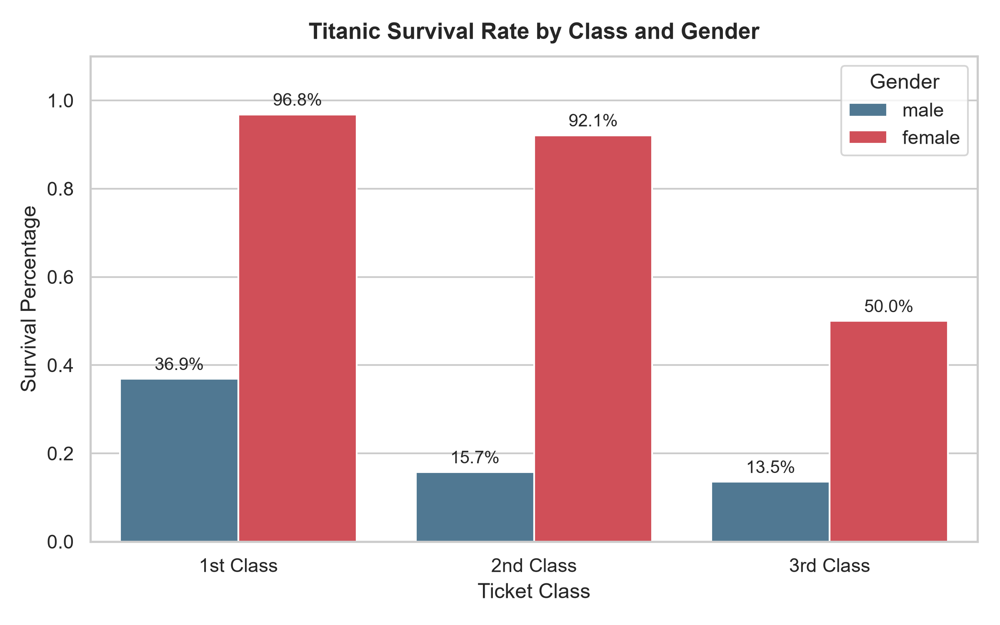
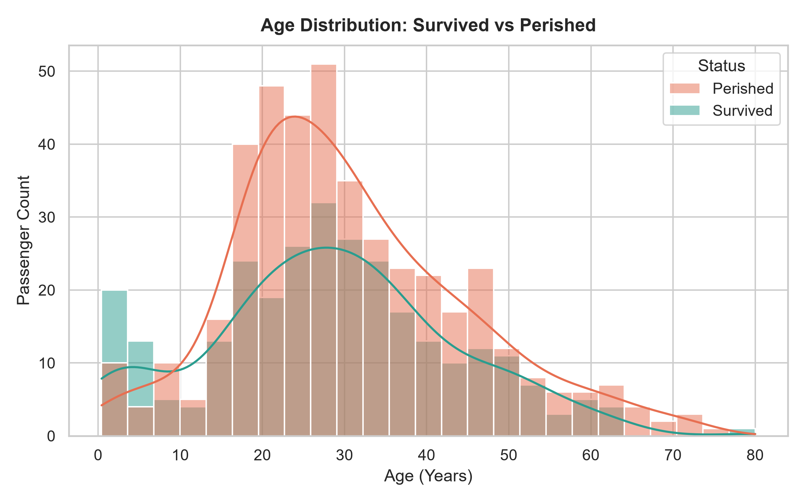
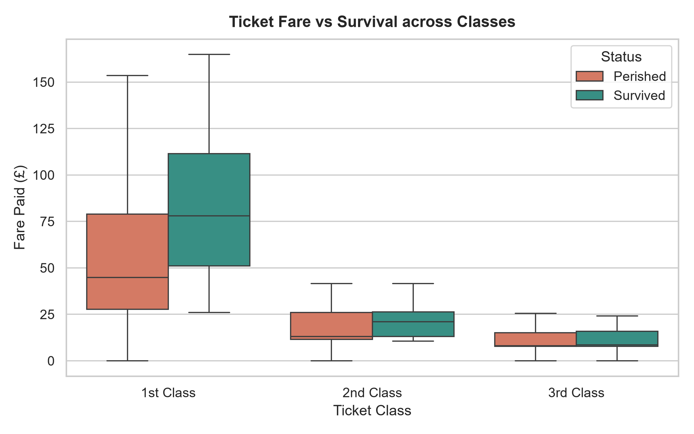
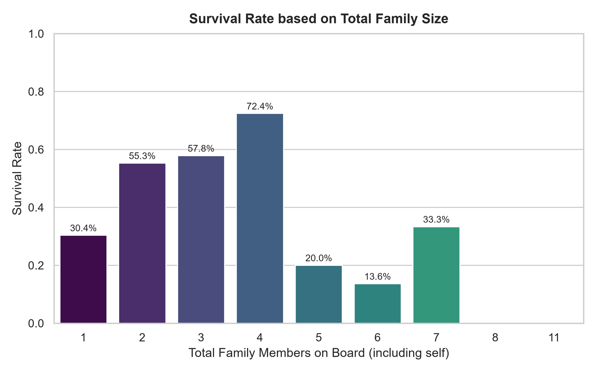
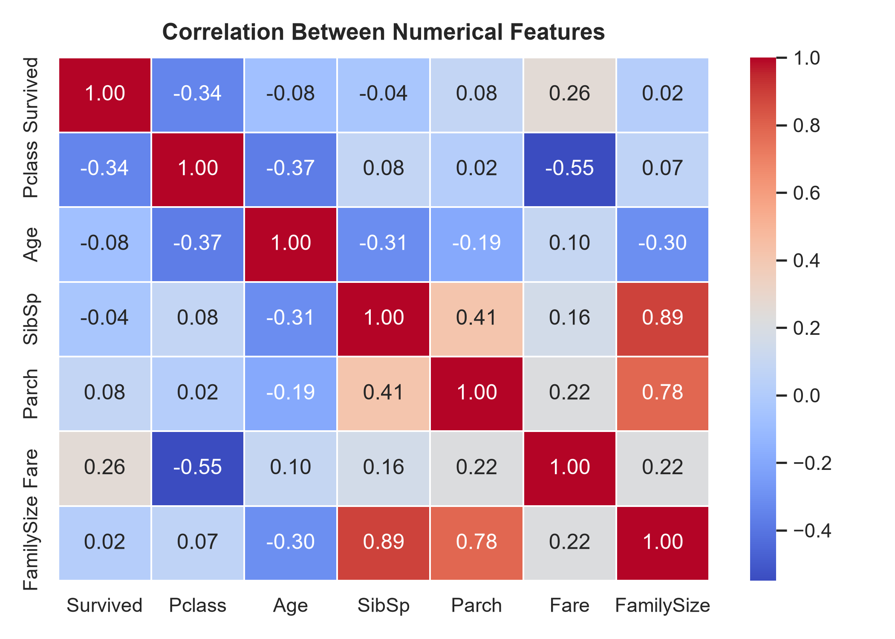

# 🚢 Titanic EDA Mini-Project (Pandas + SQL + Seaborn)

Hey there! As part of **Day 20 (Week 3)** of my AI/ML roadmap, I built this mini-project to practice end-to-end Exploratory Data Analysis (EDA) on the classic Kaggle Titanic dataset.

Rather than only using standard Pandas functions, I wanted to practice combining **Python**, **SQL (via SQLite)**, and **Seaborn** in a single pipeline — which mirrors how data analysts and machine learning engineers work with real databases.

---

## 💡 What Was the Goal?
I wanted to answer four main historical questions:
1. **The Class & Gender Divide:** Did the "women and children first" rule hold true across all ticket classes?
2. **Age Factors:** Which age brackets had the highest survival odds?
3. **Family Dynamics:** Was it better to travel solo or with family members?
4. **Ticket Fare:** How strongly was the price paid linked to passenger survival?

---

## 🛠️ Tech Used
- **Python 3**
- **Pandas** for loading and handling the CSV data.
- **SQLite3** (Python built-in) to load the table and run native SQL queries.
- **Seaborn & Matplotlib** to generate clean, readable charts.

```bash
pip install pandas seaborn matplotlib
```

---

## 🔍 SQL Queries & Findings

To make querying straightforward, the script loads `titanic.csv` into a local SQLite table called `passengers`. Here is what the SQL queries uncovered:

### 1. Overall Survival Rate
```sql
SELECT 
    COUNT(*) AS total_passengers,
    SUM(Survived) AS survivors,
    COUNT(*) - SUM(Survived) AS lost,
    ROUND(AVG(Survived) * 100, 2) AS survival_rate_pct,
    ROUND(AVG(Fare), 2) AS avg_fare
FROM passengers;
```
- **Total Passengers:** 891
- **Survivors:** 342 (~38.38%)
- **Lost:** 549 (~61.62%)
- **Average Fare:** £32.20

> **Takeaway:** Roughly only 1 in 3 passengers survived.

---

### 2. Survival by Ticket Class & Gender
```sql
SELECT 
    Pclass AS ticket_class,
    Sex AS gender,
    COUNT(*) AS total,
    SUM(Survived) AS survivors,
    ROUND(AVG(Survived) * 100, 2) AS survival_pct
FROM passengers
GROUP BY Pclass, Sex
ORDER BY Pclass, survival_pct DESC;
```
| Ticket Class | Gender | Total | Survivors | Survival Rate |
| :--- | :--- | :---: | :---: | :---: |
| **1st Class** | Female | 94 | 91 | **96.81%** |
| **1st Class** | Male | 122 | 45 | **36.89%** |
| **2nd Class** | Female | 76 | 70 | **92.11%** |
| **2nd Class** | Male | 108 | 17 | **15.74%** |
| **3rd Class** | Female | 144 | 72 | **50.00%** |
| **3rd Class** | Male | 347 | 47 | **13.54%** |

> **Takeaway:** Gender and class were the biggest factors. First-class women had almost a **97% survival rate**, while third-class men had only **13.5%**.

---

### 3. Age Groups using SQL `CASE WHEN`
```sql
SELECT 
    CASE 
        WHEN Age IS NULL THEN 'Unknown'
        WHEN Age < 13 THEN 'Children (0-12)'
        WHEN Age < 20 THEN 'Teens (13-19)'
        WHEN Age < 60 THEN 'Adults (20-59)'
        ELSE 'Seniors (60+)'
    END AS age_group,
    COUNT(*) AS total_count,
    SUM(Survived) AS survivors,
    ROUND(AVG(Survived) * 100, 2) AS survival_pct
FROM passengers
GROUP BY age_group
ORDER BY survival_pct DESC;
```
- **Children (0–12):** 57.97% survival (40 out of 69 survived)
- **Teens (13–19):** 41.05% survival
- **Adults (20–59):** 38.93% survival
- **Seniors (60+):** 26.92% survival

> **Takeaway:** Children were clearly given lifeboat preference, while seniors had the lowest survival rate.

---

### 4. Traveling Alone vs. Traveling with Family
```sql
SELECT 
    (SibSp + Parch + 1) AS family_size,
    CASE 
        WHEN (SibSp + Parch) = 0 THEN 'Solo Traveler'
        WHEN (SibSp + Parch) BETWEEN 1 AND 3 THEN 'Small Family (2-4)'
        ELSE 'Large Family (5+)'
    END AS family_type,
    COUNT(*) AS passenger_count,
    SUM(Survived) AS survivors,
    ROUND(AVG(Survived) * 100, 2) AS survival_pct
FROM passengers
GROUP BY family_type
ORDER BY survival_pct DESC;
```
- **Small Family (2–4):** **57.88%** survival rate
- **Solo Traveler:** **30.35%** survival rate
- **Large Family (5+):** **16.13%** survival rate

> **Takeaway:** Traveling with a small group of 2–4 people gave the highest survival chance. Solo travelers had lower survival rates (~30%), but large families struggled the most (~16%), likely because trying to keep large groups together during the evacuation was very difficult.

---

## 📊 Visualizations

Here are the charts generated by `eda_sql_report.py`:

### 1. Survival by Class and Gender


### 2. Age Distribution (Survived vs. Perished)


### 3. Fare Distribution across Classes


### 4. Family Size vs. Survival Odds


### 5. Correlation Heatmap


---

## 🏃 How to Run This Script

1. Make sure you have the required packages installed:
   ```bash
   pip install pandas seaborn matplotlib
   ```

2. Run the Python script:
   ```bash
   python eda_sql_report.py
   ```

The script will automatically:
- Create the SQLite database (`titanic.db`)
- Print all SQL tables right in your terminal
- Generate and save the 5 high-res charts inside the `plots/` folder

---
*Created as part of my AI/ML Roadmap portfolio.*
