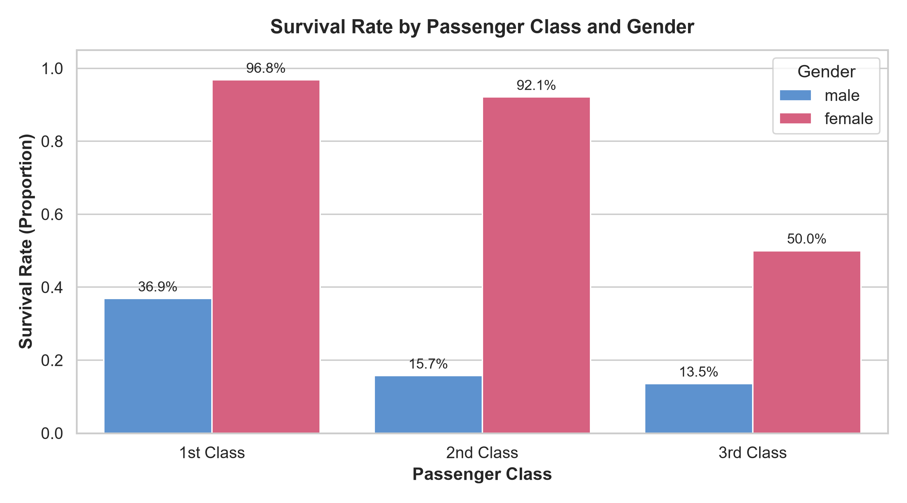
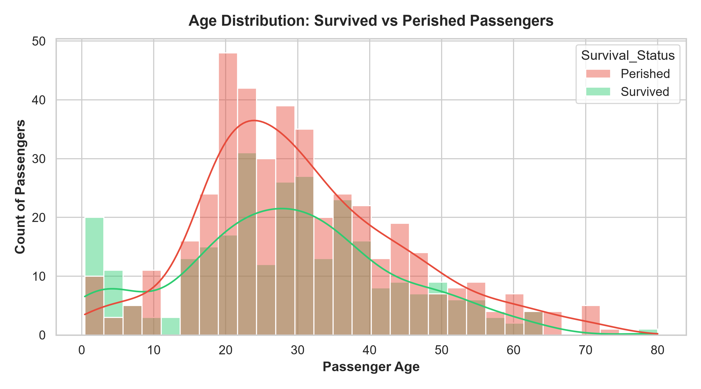
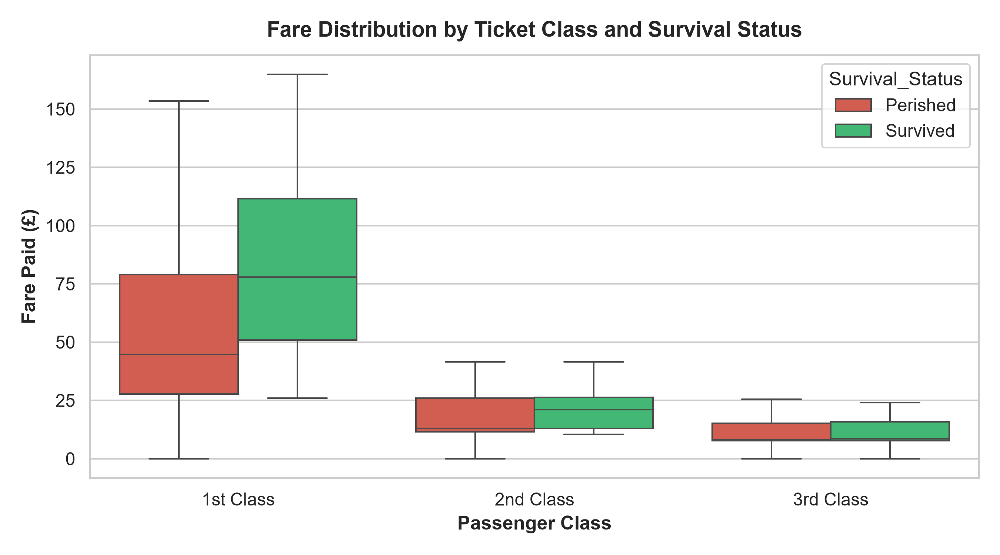
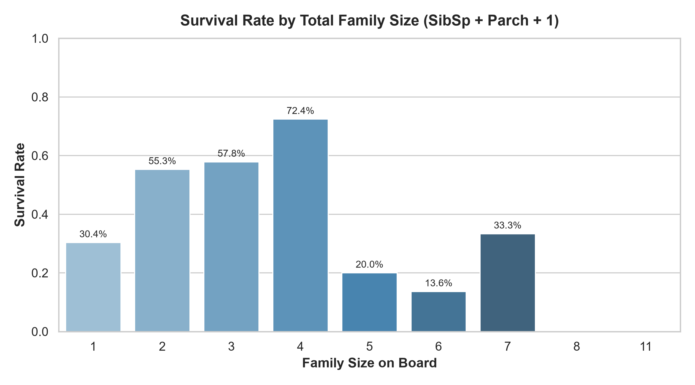
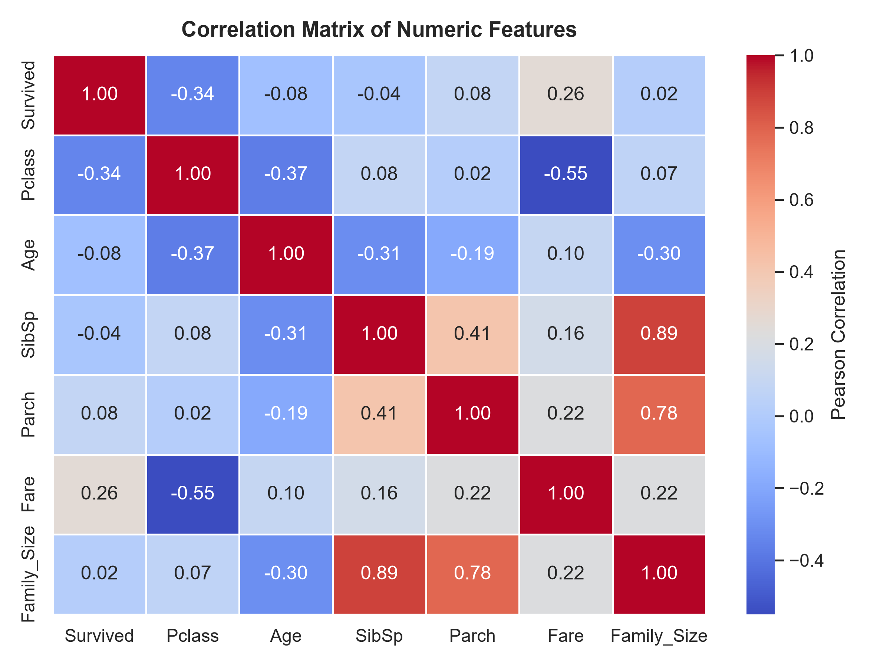

# 📊 Week 3 Mini-Project: Titanic EDA Report using Pandas, SQL & Seaborn

**Course/Roadmap Milestone:** Day 20 (Week 3) — Comprehensive Exploratory Data Analysis (EDA) on a Kaggle Dataset.

---

## 📌 Executive Summary
This project demonstrates an end-to-end Exploratory Data Analysis workflow on the classic **Kaggle Titanic: Machine Learning from Disaster** dataset. 

Instead of relying solely on Python syntax, this analysis leverages a hybrid analytical architecture:
1. **Pandas** for data ingestion, missing value verification, and transformation.
2. **SQLite (SQL)** for structured data modeling, relational aggregation, conditional segmentation (`CASE WHEN`), and business-level reporting.
3. **Seaborn & Matplotlib** for publication-quality visual storytelling and correlation analysis.

---

## 🛠️ Tech Stack & Dependencies
- **Language:** Python 3.12+
- **Data Manipulation:** `pandas`
- **Database Engine:** `sqlite3` (Native Python relational SQL engine)
- **Data Visualization:** `seaborn`, `matplotlib`

To install all required packages:
```bash
pip install pandas seaborn matplotlib
```

---

## 🗄️ Database Architecture & Ingestion
The raw CSV file (`titanic.csv`) is automatically loaded and ingested into an in-process SQLite database table named `passengers`. This allows performing SQL aggregations and queries on demand:

```python
import sqlite3
import pandas as pd

conn = sqlite3.connect("titanic.db")
df = pd.read_csv("titanic.csv")
df.to_sql("passengers", conn, if_exists="replace", index=False)
```

---

## 🔍 SQL Analytical Queries & Insights

### 1. Overall Passenger Demographics & Survival Rate
```sql
SELECT 
    COUNT(*) AS total_passengers,
    SUM(Survived) AS survivors,
    COUNT(*) - SUM(Survived) AS fatalities,
    ROUND(AVG(Survived) * 100.0, 2) AS overall_survival_rate_pct,
    ROUND(AVG(Fare), 2) AS avg_fare_paid
FROM passengers;
```
| Total Passengers | Survivors | Fatalities | Overall Survival Rate | Average Fare (£) |
| :---: | :---: | :---: | :---: | :---: |
| **891** | **342** | **549** | **38.38%** | **£32.20** |

* **Insight:** Only ~38.4% of passengers survived the disaster, establishing the baseline benchmark for future predictive modeling.

---

### 2. The Intersect of Socioeconomic Class & Gender
```sql
SELECT 
    Pclass AS passenger_class,
    Sex AS gender,
    COUNT(*) AS passenger_count,
    SUM(Survived) AS survivors,
    ROUND(AVG(Survived) * 100.0, 2) AS survival_rate_pct
FROM passengers
GROUP BY Pclass, Sex
ORDER BY Pclass ASC, survival_rate_pct DESC;
```
| Passenger Class | Gender | Total Count | Survivors | Survival Rate |
| :--- | :--- | :---: | :---: | :---: |
| **1st Class** | Female | 94 | 91 | **96.81%** |
| **1st Class** | Male | 122 | 45 | **36.89%** |
| **2nd Class** | Female | 76 | 70 | **92.11%** |
| **2nd Class** | Male | 108 | 17 | **15.74%** |
| **3rd Class** | Female | 144 | 72 | **50.00%** |
| **3rd Class** | Male | 347 | 47 | **13.54%** |

* **Insight:** The "Women and Children First" protocol is clearly evident in the data. Females in 1st Class had an astounding **96.81%** survival rate, while males in 3rd Class faced an **86.46%** fatality rate.

---

### 3. Age Demographic Segmentation (`CASE WHEN`)
```sql
SELECT 
    CASE 
        WHEN Age IS NULL THEN 'Unknown'
        WHEN Age < 13 THEN 'Child (0-12)'
        WHEN Age < 20 THEN 'Teenager (13-19)'
        WHEN Age < 60 THEN 'Adult (20-59)'
        ELSE 'Senior (60+)'
    END AS age_group,
    COUNT(*) AS total_passengers,
    SUM(Survived) AS survivors,
    ROUND(AVG(Survived) * 100.0, 2) AS survival_rate_pct
FROM passengers
GROUP BY age_group
ORDER BY survival_rate_pct DESC;
```
| Age Group | Total Passengers | Survivors | Survival Rate |
| :--- | :---: | :---: | :---: |
| **Child (0–12)** | 69 | 40 | **57.97%** |
| **Teenager (13–19)** | 95 | 39 | **41.05%** |
| **Adult (20–59)** | 524 | 204 | **38.93%** |
| **Unknown** | 177 | 52 | **29.38%** |
| **Senior (60+)** | 26 | 7 | **26.92%** |

* **Insight:** Children were prioritized for lifeboats with a **57.97%** survival rate. Seniors suffered the lowest survival rate among known age groups at **26.92%**.

---

### 4. Family Structure & Size (`SibSp + Parch + 1`)
```sql
SELECT 
    (SibSp + Parch + 1) AS family_size,
    CASE 
        WHEN (SibSp + Parch) = 0 THEN 'Solo Traveler'
        WHEN (SibSp + Parch) BETWEEN 1 AND 3 THEN 'Small Family (2-4)'
        ELSE 'Large Family (5+)'
    END AS family_category,
    COUNT(*) AS total_passengers,
    SUM(Survived) AS survivors,
    ROUND(AVG(Survived) * 100.0, 2) AS survival_rate_pct
FROM passengers
GROUP BY family_category
ORDER BY survival_rate_pct DESC;
```
| Family Category | Total Passengers | Survivors | Survival Rate |
| :--- | :---: | :---: | :---: |
| **Small Family (2–4)** | 292 | 169 | **57.88%** |
| **Solo Traveler (1)** | 537 | 163 | **30.35%** |
| **Large Family (5+)** | 62 | 10 | **16.13%** |

* **Insight:** Traveling with a small family (2–4 members) significantly increased odds of survival (**57.88%**), whereas large families faced coordination bottlenecks and experienced the highest mortality rate (**83.87%** fatality).

---

## 📈 Visualizations & Key Findings

### 1. Survival Rate by Gender & Class

- **Key Takeaway:** Across all three passenger classes, female survival rates heavily outperformed male counterparts. 1st Class males still survived at more than double the rate of 3rd Class males.

---

### 2. Age Distribution (Survived vs. Perished)

- **Key Takeaway:** A distinct spike in survival density is visible for toddlers and young children under age 8. The highest density of fatalities is concentrated in young working-class adults between 18 and 35.

---

### 3. Fare Distribution across Passenger Classes

- **Key Takeaway:** Higher fares are directly correlated with higher survival rates, particularly in 1st Class where survivors paid significantly higher median fares than those who did not survive.

---

### 4. Family Size vs. Survival Odds

- **Key Takeaway:** Survival rates peak at family sizes of 3 to 4, then drop precipitously for families of 5 or more members.

---

### 5. Correlation Heatmap of Numeric Features

- **Key Takeaway:**
  - `Pclass` is negatively correlated with `Survived` ($-0.34$), meaning lower class (higher class number: 3) strongly lowered survival chances.
  - `Fare` is positively correlated with `Survived` ($+0.26$).

---

## 🚀 How to Run Locally

1. **Clone the repository:**
   ```bash
   git clone https://github.com/muhammad-saaim-dev/AI-ML-Projects.git
   cd AI-ML-Projects
   ```

2. **Navigate to the Week 3 directory:**
   ```bash
   cd week_03_eda_sql
   ```

3. **Run the EDA & SQL pipeline:**
   ```bash
   python eda_sql_report.py
   ```
   *The script will automatically initialize the SQLite database, execute all queries, print formatted tables to the console, and generate high-resolution PNG charts in the `plots/` folder.*

---
⭐ *Completed as part of the 100-Day / Multi-Week Applied AI/ML Roadmap.*
